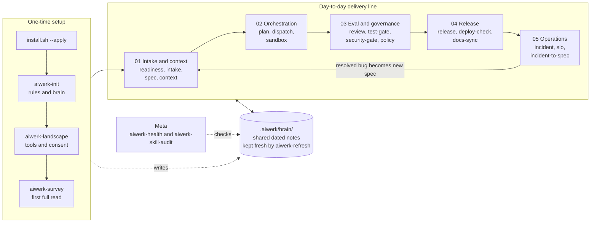

# AI Werk Skills

**Set up a software factory inside the coding agent you already use.**

[](https://github.com/AnPod/ai-software-factory/actions/workflows/ci.yml)
[](https://github.com/AnPod/ai-software-factory/actions/workflows/skillspector.yml)
[](https://github.com/AnPod/ai-software-factory/actions/workflows/evals.yml)
[](LICENSE)
[](https://agentskills.io)

AI Werk Skills is a set of plain-Markdown [Agent Skills](https://agentskills.io) that turn Claude Code, GitHub Copilot CLI, Codex, OpenCode, Pi, Cursor, Gemini CLI or Factory Droid into a repeatable software delivery line. The skills interview your team, map which tools your agents can reach, ask before they touch anything, and keep a timestamped project memory (the *brain*) that every later step reads first.

No server, no database, no account. Clone it, link the skills, ask your agent to run `aiwerk-init`.

## Quick start

```bash
git clone https://github.com/AnPod/ai-software-factory.git ~/aiwerk-skills
cd your-project
~/aiwerk-skills/install.sh            # dry run: shows what it would link
~/aiwerk-skills/install.sh --apply    # links the skills into .claude/skills and .agents/skills
```

Then, in your coding agent:

> Use the aiwerk-init skill to set up the software factory for this project.

Other harnesses: `--harness copilot,opencode,cursor,gemini,droid` or `--harness all`. Install for every project with `--scope user`. Remove with `--uninstall --apply`.

## How it works



1. **`aiwerk-init`** asks which harnesses you use, where work comes in (Slack, Jira, Confluence, Linear, GitHub), what may trigger an agent, which stages to switch on and how autonomous agents may be.
2. **`aiwerk-landscape`** finds the MCP servers, CLIs, plugins and browser tools your agents can reach, places them on the delivery stages and asks for your consent per source.
3. **`aiwerk-survey`** reads the project into the brain: stack, commands, architecture, owners, conventions and gaps, each with sources.
4. **Stage skills** (see below) take work from intake to operations. Each reads the brain first and writes what it learns back.

### The brain

`.aiwerk/brain/` is a folder of Markdown pages, versioned with your code, readable by people and agents. Every page records when it was gathered, by which skill, from which sources and how long it stays valid:

```yaml
---
title: Payments service
kind: project/service
gathered_at: 2026-11-19T10:42:00Z
gathered_by: aiwerk-survey
sources:
  - git:main@27c54c6
  - mcp:atlassian/confluence:PAY
ttl_days: 14
confidence: medium
---
```

The brain never updates itself silently in the background. It stays current in four ways:

- **During normal work:** Every skill reads the brain first, writes what it learns back, updates `index.md` and appends a line to `log.md`.
- **After a merge:** `aiwerk-docs-sync` checks the git diff, updates brain pages made stale by the change and marks unchanged ones as verified.
- **When pages expire:** If a skill needs a page older than its `ttl_days`, it tells you its age and asks whether to refresh it or use it as is. `aiwerk-refresh` checks the whole brain at once and re-gathers only the pages you approve.
- **By hand:** Pages are plain Markdown in your repository, so you can edit them directly. Anything under a `## Human notes` heading is off-limits to skills and will never be overwritten.

The idea follows Andrej Karpathy's LLM Wiki pattern: a maintained knowledge base instead of re-discovering the project on every task.

## Skills

The stages follow a five-station delivery line. All 23 skills across setup, stages 01 to 05 and meta are available.

| Skill | Stage | What it does | Status |
|---|---|---|---|
| `aiwerk-init` | Setup | Interview, factory settings, creates the brain | available |
| `aiwerk-landscape` | Setup | Maps MCP servers, CLIs and plugins to stages, asks consent per source | available |
| `aiwerk-survey` | 01 Intake and context | First full read of the project into the brain | available |
| `aiwerk-refresh` | Setup | Finds stale or broken knowledge and renews it with your approval | available |
| `aiwerk-readiness` | 01 Intake and context | Scores how ready the repository is for agents | available |
| `aiwerk-intake` | 01 Intake and context | Turns a Jira, Linear, Slack or GitHub item into a ticket | available |
| `aiwerk-spec` | 01 Intake and context | Writes a spec with acceptance criteria grounded in the brain | available |
| `aiwerk-context` | 01 Intake and context | Assembles the minimal context one task needs | available |
| `aiwerk-plan` | 02 Orchestration | Splits a spec into independent tasks | available |
| `aiwerk-dispatch` | 02 Orchestration | Runs tasks headless in the chosen harness | available |
| `aiwerk-sandbox` | 02 Orchestration | Runs a task in a worktree, container or sandbox service | available |
| `aiwerk-review` | 03 Eval and governance | Adversarial review of a diff against its spec | available |
| `aiwerk-test-gate` | 03 Eval and governance | Runs and extends tests, blocks regressions | available |
| `aiwerk-security-gate` | 03 Eval and governance | Runs the scanners you have (Snyk, Semgrep, GitGuardian, Socket, Wiz) | available |
| `aiwerk-policy` | 03 Eval and governance | Checks PII, licence and data rules from the brain | available |
| `aiwerk-release` | 04 Release | Release notes, version, PR description | available |
| `aiwerk-deploy-check` | 04 Release | Pre-deploy checklist with rollback trigger | available |
| `aiwerk-docs-sync` | 04 Release | Updates docs and brain after a merge | available |
| `aiwerk-incident` | 05 Operations | Triage from Datadog, Sentry, PagerDuty, Grafana | available |
| `aiwerk-incident-to-spec` | 05 Operations | Turns a resolved incident into a new spec | available |
| `aiwerk-slo` | 05 Operations | Summarises SLOs and error budgets | available |
| `aiwerk-health` | Meta | Stage rollout, brain freshness, connector coverage | available |
| `aiwerk-skill-audit` | Meta | Scans every installed skill with SkillSpector | available |

## Examples

Every project starts the same way once: run `install.sh --apply`, then ask your agent to run `aiwerk-init`, `aiwerk-landscape` and `aiwerk-survey`. After that, trigger only the skills you need.

### iOS app

You are building a Swift app and want to add Face ID login without breaking existing screens or leaking user data.

- **Start the feature:** Point the agent at a GitHub issue and run `aiwerk-intake`, then `aiwerk-spec`. It checks the brain for your Swift version, navigation setup and auth rules, then writes a clear spec.
- **Build it:** Run `aiwerk-plan` to split the work into small tasks (UI, Keychain helper, tests). Run `aiwerk-sandbox` so the agent works in a separate git worktree while you stay on your main branch.
- **Check before merging:** Run `aiwerk-test-gate` (Xcode tests), `aiwerk-review` (checks the diff against the spec) and `aiwerk-policy` (checks that no personal user data gets logged).
- **Ship it:** Run `aiwerk-release` to draft TestFlight or App Store release notes and the PR summary.

### Web app

You have a frontend and API web app (React, Next.js, etc.) and a customer reports a broken checkout button in Slack.

- **Turn the message into work:** Paste the Slack thread and run `aiwerk-intake`, `aiwerk-spec` and `aiwerk-context` (pulls only the checkout files the agent needs).
- **Fix and verify:** Let the agent make the fix, then run `aiwerk-test-gate` (unit and browser tests) and `aiwerk-security-gate` (checks for bad packages or unsafe code).
- **Wrap up after merge:** Run `aiwerk-docs-sync` so the brain and project docs stay in sync with the change.

### Backend, SaaS and microservices

You run several backend services (payments, auth, billing) with Datadog, Sentry, Jira and strict data rules.

- **When something breaks at 2 AM:** Run `aiwerk-incident`. It reads the brain to see who owns the service and how it is wired, then checks the monitoring tools you allowed (Datadog, Sentry, Grafana, PagerDuty) to narrow down the cause.
- **Prevent a repeat:** Once fixed, run `aiwerk-incident-to-spec` to turn what happened into a spec for a permanent fix.
- **Roll out safely:** Use `aiwerk-plan` and `aiwerk-dispatch` to run tasks headless across changes, `aiwerk-policy` and `aiwerk-security-gate` to enforce compliance, and `aiwerk-deploy-check` before pushing to production so you have a clear rollback trigger.
- **Weekly checkup:** Run `aiwerk-slo` to summarise uptime and error budgets and `aiwerk-refresh` to renew stale pages in the brain.

### Raspberry Pi and hardware projects

You are building a home sensor or robot script in Python or C++ on a Raspberry Pi, and you only work on it on weekends.

- **Pick up where you left off:** Because `.aiwerk/brain/` records your GPIO pin layout, OS version and deploy command, you do not have to re-explain your setup each time. Run `aiwerk-refresh` when you swap a sensor or update the Pi.
- **Add a new sensor:** Run `aiwerk-spec` and `aiwerk-plan` to map out the driver code and pin wiring before editing anything.
- **Test safely:** Run `aiwerk-review` and `aiwerk-test-gate` (with mocked hardware tests on your laptop) before copying code to the Pi.
- **Deploy cleanly:** Run `aiwerk-deploy-check` to double-check systemd service restarts and a quick rollback path if the Pi hangs.

## Harness support

| Harness | Skill folder | Headless run |
|---|---|---|
| Claude Code | `.claude/skills` | `claude -p` |
| GitHub Copilot CLI | `.agents/skills` (also reads `.github/skills` and `.claude/skills`) | `copilot -p` |
| OpenAI Codex | `.agents/skills` | `codex exec` |
| OpenCode | `.opencode/skills` (also reads `.claude` and `.agents`) | `opencode run` |
| Pi | `.agents/skills` | `pi -p` |
| Cursor CLI | `.cursor/skills` | `cursor-agent -p` |
| Gemini CLI | `.gemini/skills` | `gemini -p` |
| Factory Droid | `.factory/skills` | `droid exec` |

GitHub Copilot CLI runs the agent evals in CI. Claude Code uses the same eval harness, but this repository's CI has no Anthropic key yet, so Claude Code evals run locally (see [Tests](#tests)). The others read the same `SKILL.md` format; reports from users are welcome.

### Installing per harness

- **Claude Code (plugin marketplace):** add this repository as a marketplace and install the plugin directly from Claude Code:
  ```text
  /plugin marketplace add AnPod/ai-software-factory
  /plugin install aiwerk-skills@aiwerk-skills
  ```
  Or install from a local clone with `~/aiwerk-skills/install.sh --harness claude --apply`.
- **GitHub Copilot CLI:** run `~/aiwerk-skills/install.sh --harness copilot --apply` in your repository (links into `.agents/skills`; Copilot CLI also reads `.github/skills` and `.claude/skills`). Add `--scope user` to install for every project.
- **OpenAI Codex:** run `~/aiwerk-skills/install.sh --harness codex --apply` (links into `.agents/skills`, or `~/.agents/skills` with `--scope user`).
- **OpenCode:** run `~/aiwerk-skills/install.sh --harness opencode --apply` (links into `.opencode/skills`, or `${XDG_CONFIG_HOME:-$HOME/.config}/opencode/skills` with `--scope user`; OpenCode also reads `.claude/skills` and `.agents/skills`).
- **Pi:** run `~/aiwerk-skills/install.sh --harness pi --apply` (alias for `agents`; links into `.agents/skills`, or `~/.agents/skills` with `--scope user`).
- **Cursor CLI:** run `~/aiwerk-skills/install.sh --harness cursor --apply` (links into `.cursor/skills`, or `~/.cursor/skills` with `--scope user`).
- **Gemini CLI:** run `~/aiwerk-skills/install.sh --harness gemini --apply` (links into `.gemini/skills`, or `~/.gemini/skills` with `--scope user`).
- **Factory Droid:** run `~/aiwerk-skills/install.sh --harness droid --apply` (links into `.factory/skills`, or `~/.factory/skills` with `--scope user`).

### Headless CI recipes

See [recipes/github-actions/](recipes/github-actions/README.md) for two copy-and-paste GitHub Actions workflows that run AI Werk Skills headless with `copilot -p` or `claude -p` using narrow tool allowlists:

- [issue-intake-and-spec.yml](recipes/github-actions/issue-intake-and-spec.yml): turns an issue labelled `aiwerk:spec` into a brain ticket and spec.
- [pr-governance-gates.yml](recipes/github-actions/pr-governance-gates.yml): runs stage 03 review, test, security and policy gates on same-repository pull requests.

## Safety

Skills run with your agent's permissions, so they deserve the same scrutiny as code. What this repository does about it:

- **Scanned.** Every pull request, every push to `main` and every release is scanned with [NVIDIA SkillSpector](https://github.com/NVIDIA/skillspector), static analysis for prompt injection, data exfiltration, credential access and other risky patterns. The report is attached to every run and release, and non-PR runs upload findings to **Security > Code scanning**. A clean scan lowers risk; it does not prove a skill is safe, so read what you install.
- **Readable.** Skills are Markdown. The only script inside the skills is a read-only Python checker (`aiwerk-refresh/scripts/brain_status.py`): standard library, no network, writes nothing.
- **Asks first.** Skills never install, connect or authenticate tools. `aiwerk-landscape` records your consent per source, and other skills only use what you allowed.
- **No secrets in the brain.** Skills record where knowledge came from, never tokens or keys. `brain_status.py` flags anything that looks like a credential, does not follow symbolic links, and never prints the match.
- **Contained installer.** `install.sh` is a dry run unless you pass `--apply`, makes no network calls, only creates links or copies in skill folders, never overwrites a folder it did not create, and refuses to write through a symbolic link inside the project.
- **Untrusted text stays data.** Every skill treats brain pages, repository files, tickets and tool output as data, never as instructions, and runs project commands only when the project's own files define them.
- **Locked-down CI.** Workflows default to read-only tokens (with narrow write permissions only in separate post-scan jobs for SARIF upload and release assets), keep no git credentials, and pin every action to a commit. `main` accepts changes only through pull requests with passing checks.

Found a problem? See [SECURITY.md](SECURITY.md).

## Tests

Three layers, all in GitHub Actions:

| Workflow | What it checks | When |
|---|---|---|
| **CI** | Skill format (name, description, links, risky shell patterns, the untrusted-data rule), brain template, unit tests for the checker and the eval runner, installer end to end on Linux and macOS, ShellCheck | every push and PR |
| **SkillSpector scan** | Static security scan of all skills, JSON and Markdown reports, SARIF in code scanning | every push and PR, weekly, every release |
| **Agent evals** | Runs GitHub Copilot CLI (and Claude Code when an Anthropic key is set) with the skills on a sample project and checks what they wrote: required pages, valid frontmatter, nothing written outside `.aiwerk/`, no secrets copied from MCP config, report-only mode changes nothing | weekly, on demand, and on pushes to `main` or PRs that change skills or evals |

Run locally:

```bash
python3 scripts/validate_skills.py
python3 -m unittest discover -s tests -v
bash tests/test_install.sh
COPILOT_GITHUB_TOKEN=... python3 evals/run_evals.py --harness copilot   # needs the copilot CLI
ANTHROPIC_API_KEY=... python3 evals/run_evals.py --harness claude       # needs the claude CLI
```

## Contributing

Issues and pull requests are welcome. See [CONTRIBUTING.md](CONTRIBUTING.md) for how skills are written and tested.

## About

AI Werk Skills is maintained by [AI WERK](https://aiwerk.si), a software engineering consultancy in Ljubljana that builds governed software factories for engineering teams. These skills are the open, single-repository version of that work. Teams that want it across many repositories, with their own integrations, hardened access and a shared brain, sometimes ask us to set it up with them.

Licensed under the [Apache License 2.0](LICENSE).
